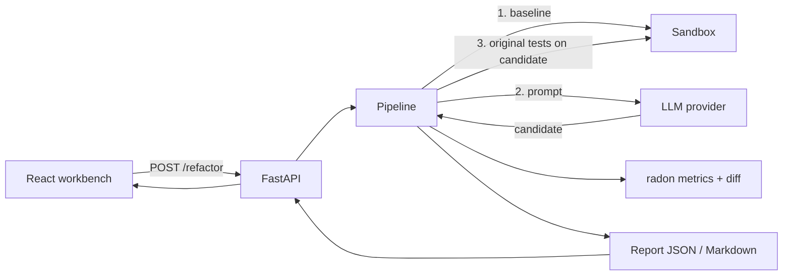

# Metamorph

> A code workbench that asks a language model to refactor your Python, then **accepts the result only if your original tests still pass**.

**Status: v0.2.0.** The browser workbench and the Python verification engine are implemented, with an automated test suite for the engine. Benchmarks are **not yet published**: the repository ships an [evaluation harness](engine/eval/README.md) but no results.

## What it does

1. You paste Python source and a pytest file into the browser UI (or call the REST API).
2. The engine runs the tests against the **original** code. If they fail, it stops: there is nothing to verify against.
3. It asks a model (local Ollama or any OpenAI-compatible endpoint) for a refactor.
4. It runs the **original** tests against the candidate. If they fail, the failure output goes back to the model for another try, up to a limit.
5. An accepted refactor comes with a unified diff and before/after metrics (lines, cyclomatic complexity, maintainability index). A rejected run says why.

> **Read this before trusting a result.** Verification means "the tests you supplied still pass". It cannot prove the refactor preserves behaviour your tests do not cover. Weak tests give weak guarantees. See [ADR 0001](docs/adr/0001-verify-by-existing-tests.md).

## Components

| Part | Where | Notes |
|---|---|---|
| Browser workbench | `src/` (React 19, Vite 6, Tailwind 4, Monaco) | Edit and run code, ask for a suggestion, run a verified refactor |
| Verification engine | `engine/` (Python 3.12, FastAPI, radon, httpx) | Refactor-and-verify loop, sandboxed test runs, REST API, evaluation harness |
| Model backends | `engine/src/metamorph_engine/providers/` | Ollama, OpenAI-compatible, and a scripted fake for tests |

The original browser features still work: JavaScript runs in a Web Worker, other languages run through [Judge0](https://judge0.com) when a key is configured, and **Suggest refactor** returns an unverified suggestion from Ollama.

## Architecture



Sequence diagram, trust boundaries and design notes: [docs/ARCHITECTURE.md](docs/ARCHITECTURE.md). Decisions: [docs/adr](docs/adr).

## Project structure

```
src/                         React UI
  App.jsx                    state and layout
  components/VerifiedResult.jsx   verdict, attempts, metrics, diff
  lib/engine.js              client for the engine API
  lib/runJs.js, judge0.js, ollama.js   original runners and suggestion client
engine/
  src/metamorph_engine/
    models.py                request, result and report types
    pipeline.py              the refactor-and-verify loop
    providers/               LLMProvider + Ollama, OpenAI-compatible, fake
    sandbox/                 subprocess runner (default) and Docker runner (optional)
    metrics.py               radon metrics and unified diff
    report.py                Markdown report
    api.py                   FastAPI app
    evaluation.py            evaluation harness
  eval/                      harness launcher and three hand-written sample cases
  tests/                     pytest suite
  docker/sandbox.Dockerfile  image for the Docker sandbox
docs/                        architecture, roadmap, ADRs
docker-compose.yml           engine + Ollama for local use
```

## Getting started

### Engine (Python 3.12)

```bash
cd engine
pip install -e ".[dev]"
make check                 # ruff, mypy, pytest
make run                   # http://127.0.0.1:8000, interactive docs at /docs
```

Run a local model, for example `ollama pull codellama`, or point the engine at an OpenAI-compatible endpoint. Configuration is by environment variable; see [engine/.env.example](engine/.env.example).

### UI (Node 20+)

```bash
npm install
cp .env.example .env.local     # optional
npm run dev
```

### Docker (optional)

`docker compose up --build` starts the engine and Ollama bound to localhost. See [docker-compose.yml](docker-compose.yml).

## API

| Method and path | Purpose |
|---|---|
| `POST /refactor` | Body: `source`, `tests`, optional `module_name` (default `solution`), `max_attempts`, `instructions`. Returns a run report. |
| `GET /runs/{id}` | A stored report as JSON |
| `GET /runs/{id}/report.md` | The same report as Markdown |
| `GET /health` | Status, provider and sandbox in use |

Verdicts: `accepted`, `rejected`, `baseline_failed`, `provider_error`.

## Configuration

| Variable | Purpose | Default |
|---|---|---|
| `METAMORPH_PROVIDER` | `ollama` or `openai` | `ollama` |
| `METAMORPH_OLLAMA_URL`, `METAMORPH_OLLAMA_MODEL` | Ollama endpoint and model | `http://localhost:11434`, `codellama` |
| `METAMORPH_OPENAI_BASE_URL`, `_API_KEY`, `_MODEL` | OpenAI-compatible endpoint | unset |
| `METAMORPH_MAX_ATTEMPTS` | Attempts per run | `3` |
| `METAMORPH_TEST_TIMEOUT_S` | Seconds per test run | `10` |
| `METAMORPH_MEMORY_MB` | Memory cap per test run (POSIX) | `512` |
| `METAMORPH_SANDBOX` | `subprocess` or `docker` | `subprocess` |
| `METAMORPH_CORS_ORIGINS` | Allowed browser origins | `http://localhost:5173` |
| `VITE_ENGINE_URL` | Engine URL used by the UI | `http://127.0.0.1:8000` |

The UI also reads `VITE_JUDGE0_*` and `VITE_OLLAMA_*` for the original features. `VITE_*` values are bundled into the browser build, so use throwaway keys there. No credentials are stored in this repository.

## Evaluation

`engine/eval/` runs the loop over a folder of legacy snippets and writes a CSV. Run it against your own model:

```bash
cd engine && python eval/run_eval.py --cases eval/cases --out results.csv
```

The bundled cases are short samples written by hand for this project. No results are included; see [engine/eval/README.md](engine/eval/README.md).

## Security

The engine **executes code it is sent**. The default sandbox is a child process with a timeout and POSIX memory, CPU and file-size limits. That contains accidents, not attackers: the child runs as the same user and can use the network. Run the engine on localhost only, or inside a container, or enable the Docker sandbox (network-less, read-only, capped). Details: [ADR 0003](docs/adr/0003-sandboxing-tradeoffs.md).

## Limitations

- **Python only** for verified refactoring. Other languages run in the browser or Judge0 but are not verified.
- Verification is only as strong as the supplied tests, and cannot detect behaviour changes the tests miss. A model could also special-case the tests; the engine does not detect that.
- Static metrics are heuristics for readability, not proof of quality.
- The subprocess sandbox is not a security boundary.
- Memory limits (`RLIMIT_AS`) are applied on POSIX only and may not be enforced on every platform.
- Run reports are kept in memory (last 200) and lost on restart.
- Refactoring is single-file; there is no multi-module or project-level context.
- The Worker used for in-browser JavaScript can still make network requests.
- Monaco loads its assets from a CDN, so the editor needs internet access.
- The Docker sandbox and compose file are written but have not been exercised in CI.

## Roadmap

See [docs/ROADMAP.md](docs/ROADMAP.md).

## License

[MIT](LICENSE) © 2026 Praneetha Potharaju
