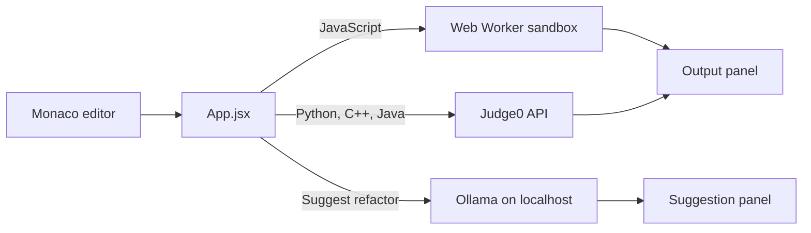

# Metamorph

> A browser-based code workbench: write code, run it, and ask a local LLM for a refactor suggestion.

**Status: early prototype.** Editing, running and requesting refactor suggestions work. Suggestions are **not** verified automatically; test-verified refactoring is the planned next step (see [Roadmap](#roadmap)).

## Features

- Monaco editor (the VS Code editor) with JavaScript, Python, C++ and Java modes.
- **JavaScript** runs inside a Web Worker with a 3-second timeout; `console.log` output and the final expression are shown in the page.
- **Python / C++ / Java** run remotely through the [Judge0](https://judge0.com) API (RapidAPI) when a key is configured.
- **Suggest refactor** sends the current code to a local [Ollama](https://ollama.com) model (default `codellama`) and shows the reply, labelled as unverified.

## Tech stack

React 19, Vite 6, Tailwind CSS 4, `@monaco-editor/react`, axios. ESLint for linting.

## Architecture



Details and the planned verification pipeline: [docs/ARCHITECTURE.md](docs/ARCHITECTURE.md).

## Project structure

```
src/
  App.jsx          UI and state
  lib/runJs.js     worker-based JavaScript runner
  lib/judge0.js    remote execution client
  lib/ollama.js    refactor suggestion client
  main.jsx         entry point
```

## Getting started

Requires Node.js 20+.

```bash
npm install
cp .env.example .env.local   # optional, see below
npm run dev
```

For refactor suggestions, run Ollama locally and pull a model: `ollama pull codellama`.

### Configuration

| Variable | Purpose | Default |
|---|---|---|
| `VITE_JUDGE0_KEY` | RapidAPI key for remote execution. Remote runs are disabled when unset. | unset |
| `VITE_JUDGE0_URL` | Judge0 base URL | `https://judge0-ce.p.rapidapi.com` |
| `VITE_OLLAMA_URL` | Ollama base URL | `http://localhost:11434` |
| `VITE_OLLAMA_MODEL` | Ollama model name | `codellama` |

`VITE_*` variables are bundled into the browser build, so use a throwaway key or place a proxy in front of Judge0. No credentials are stored in this repository.

## Scripts

| Script | Description |
|---|---|
| `npm run dev` | Start the dev server |
| `npm run build` | Production build |
| `npm run preview` | Preview the production build |
| `npm run lint` | Run ESLint |

## Limitations

- Refactor suggestions come from a model and are **not checked** against tests.
- The Worker sandbox isolates code from the page DOM but does not stop it from making network requests; it is meant for your own snippets, not untrusted code.
- Remote execution depends on a third-party API and exposes the key to the browser.
- Monaco loads its assets from a CDN by default, so the editor needs internet access.
- No automated tests yet.

## Roadmap

See [docs/ROADMAP.md](docs/ROADMAP.md). In short: parse the code, generate a refactor, then accept it only if the original tests still pass.

## License

[MIT](LICENSE) © 2026 Praneetha Potharaju
