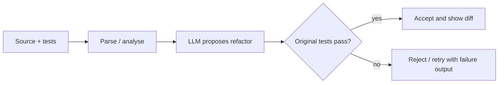

# Metamorph architecture

## Current design

Single-page React app; there is no backend.

| Concern | Module | Notes |
|---|---|---|
| Editing | `@monaco-editor/react` in `App.jsx` | language chosen from a fixed list |
| JavaScript execution | `src/lib/runJs.js` | one Web Worker per run, terminated on completion or after 3 s; console output captured and returned |
| Other languages | `src/lib/judge0.js` | POST to Judge0 with `wait=true`; returns stdout, stderr or compile output |
| Refactor suggestion | `src/lib/ollama.js` | POST to `/api/generate` on a local Ollama server, non-streaming |

State lives in `App.jsx` (`code`, `language`, `output`, `suggestion`, `busy`). Buttons are disabled while a request is in flight.

## Trust and security

- Code typed by the user is executed either in a Worker (JavaScript) or on Judge0 (other languages); it is never evaluated in the page context.
- API configuration comes from `VITE_*` variables. These are visible in the built bundle, so secrets are only appropriate for throwaway keys.
- The Ollama call stays on the user's machine.

## Planned design: verified refactoring

Not implemented. Target pipeline:

Open design questions: which test runner interface to support per language, how to bound retries, and where to execute tests safely (a server-side sandbox rather than the browser).
