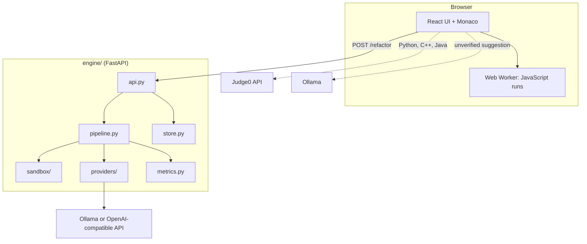
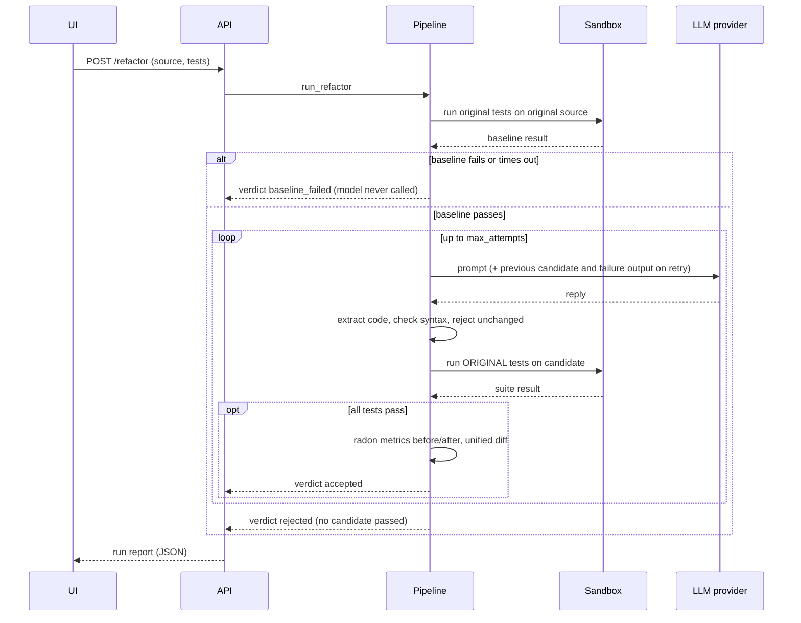

# Metamorph architecture

Two cooperating parts: a **browser workbench** and a **Python engine** that does the verified refactoring.

Solid lines are the verified flow. Dotted lines are the original, unverified browser features.

## Refactor-and-verify sequence

## Modules

| Module | Responsibility |
|---|---|
| `models.py` | Pydantic types. `RefactorRequest` validates that source and tests parse as Python and that `module_name` is a safe identifier that does not shadow the standard library. |
| `pipeline.py` | The loop. Pure orchestration; depends only on the `LLMProvider` and `Sandbox` interfaces, so tests drive it with a scripted provider. |
| `providers/` | `LLMProvider` protocol (`complete(prompt, system)`), Ollama and OpenAI-compatible adapters, and `FakeProvider`. All backend failures become `LLMError`. |
| `sandbox/` | `Sandbox` protocol. `SubprocessSandbox` (default) and `DockerSandbox` (optional). Both return a `SuiteResult` and raise `SandboxError` only when the sandbox itself cannot run. |
| `prompts.py` | Prompt text and extraction of a code block from a model reply. |
| `metrics.py` | radon: raw counts, per-function cyclomatic complexity, maintainability index; unified diff. |
| `report.py` | Markdown rendering of a report. JSON is the model itself. |
| `store.py` | Thread-safe in-memory store of the last 200 runs. |
| `evaluation.py` | Batch runner over a folder of cases, CSV output. |
| `config.py` | Settings from `METAMORPH_*` variables with validation. |

## Decisions that shape behaviour

- **Baseline first.** If the tests do not pass on the original, or no tests are collected (pytest exit code 5), the run stops without calling the model. An empty suite can never verify anything.
- **Original tests only.** The candidate is judged by the tests as supplied; the model never sees an opportunity to change them.
- **Failure feedback.** On retry, the model receives its previous attempt and the tail of the pytest output.
- **Unusable answers count as attempts.** Replies with no code, invalid syntax, or unchanged code are recorded and retried, not treated as errors.
- **Sandbox failures are not verdicts.** A missing Docker daemon returns HTTP 503, not "rejected".

## Trust and security

| Boundary | Treatment |
|---|---|
| Source and tests (untrusted) | Parsed with `ast`; executed only inside the sandbox |
| Model output (untrusted) | Parsed and tested before it is accepted; never executed outside the sandbox |
| Subprocess sandbox | Timeout, process-group kill, POSIX `RLIMIT_AS`/`CPU`/`FSIZE`, minimal environment, throwaway directory. **Not a security boundary.** |
| Docker sandbox | `--network none`, read-only root, tmpfs `/tmp`, `--cap-drop ALL`, `no-new-privileges`, memory, CPU and PID limits |
| API | Intended for localhost. CORS limited to configured origins. No authentication. |
| Secrets | Read from environment variables; none in the repository |

A test suite that exits with code 0 by calling `os._exit(0)` would pass verification. The engine trusts the supplied tests; see [ADR 0001](adr/0001-verify-by-existing-tests.md).

## Browser workbench

Single-page React app. `App.jsx` holds `code`, `language`, `output`, `suggestion`, `tests`, `moduleName`, `report`, `engineError` and `busy`. JavaScript runs in a Web Worker (3-second timeout); Python, C++ and Java run through Judge0 when `VITE_JUDGE0_KEY` is set. The Python-only verification panel appears when the language is Python and posts to the engine through `src/lib/engine.js`, which never throws and returns either a report or an error message. `VerifiedResult.jsx` renders the verdict, attempts, metric table and diff.

## Related decisions

- [ADR 0001: verify by the existing tests](adr/0001-verify-by-existing-tests.md)
- [ADR 0002: provider abstraction](adr/0002-llm-provider-abstraction.md)
- [ADR 0003: sandboxing trade-offs](adr/0003-sandboxing-tradeoffs.md)
- [ADR 0004: a Python engine alongside the browser UI](adr/0004-python-engine-beside-ui.md)
